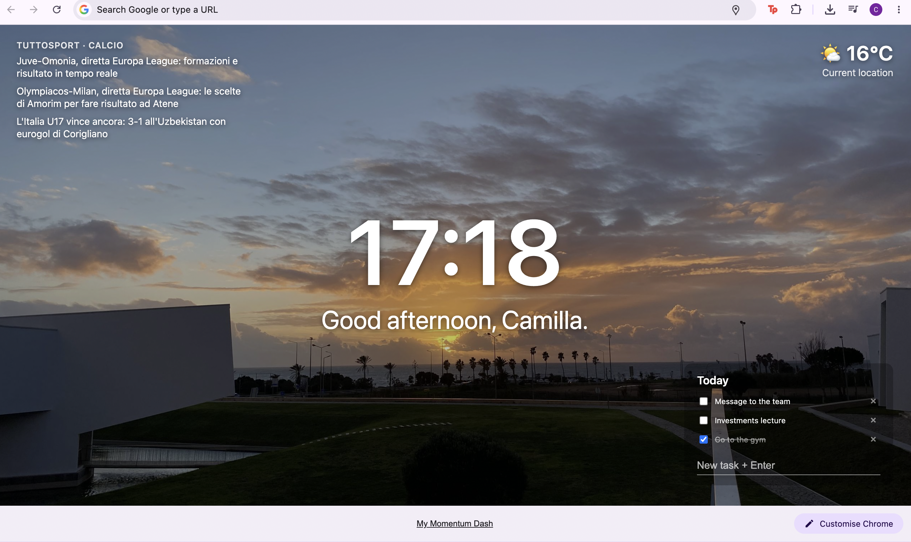

# My Momentum Dash

A Chrome extension that replaces the New Tab page with a personal dashboard, inspired by [Momentum](https://momentumdash.com/). It is my version of the first project of the individual assignment.

## Purpose

Every time I open a new tab in Chrome, the extension shows:

- a large **clock** and a **greeting** with my name that changes with the time of day (morning / afternoon / evening);
- a **daily to-do list**: I add tasks, tick them to cross them out, and completed tasks disappear automatically the next day;
- one of **my own photos of Lisbon** as the background, changing every hour;
- the **current weather** (icon and temperature) for my location, with Lisbon as the fallback;
- the **3 latest football headlines from Tuttosport**, which open the article when clicked.

I wanted something I would really use every day: my tasks, the weather and football news in one place.

## Data collection

| Data | Source | How it is obtained |
| --- | --- | --- |
| Time and date | The computer's clock | `new Date()` in JavaScript |
| Name and tasks | Typed by the user | Input boxes on the page |
| Background photos | My own photos of Lisbon | Stored in the `images/` folder of the extension |
| Weather | [Open-Meteo](https://open-meteo.com/) (free, no API key) | `fetch` request to `https://api.open-meteo.com/v1/forecast` with latitude, longitude, `temperature_2m` and `weather_code`; refreshed every 30 minutes |
| Location for the weather | The browser's geolocation (`navigator.geolocation`) | Coordinates rounded to 2 decimals (about 1 km) before being sent to Open-Meteo; if location is refused or unavailable, Lisbon's coordinates are used |
| Football headlines | Tuttosport's public RSS feed `https://www.tuttosport.com/rss/calcio` | `fetch` of the XML feed, read with `DOMParser`; only the first 3 titles and links are shown, with the source named; refreshed every 30 minutes |

The photos were prepared before publishing: converted from iPhone HEIC to JPEG (Chrome cannot display HEIC), resized to 2560 px, all metadata removed (including GPS location), one recognisable person cropped out and one car number plate pixelated.

## Data persistence

| What | Where | Why |
| --- | --- | --- |
| My name (`userName`) | `chrome.storage.local` | So the greeting works in every new tab without asking again, and without writing my name in the code |
| My tasks (`todos`) and the date they were last saved (`todosDate`) | `chrome.storage.local` | So tasks survive closing the tab; the date is used to remove completed tasks when a new day starts |

`chrome.storage.local` is a small storage area that Chrome gives each extension. It stays **only in this browser on this computer**: it is not synced, it is not part of the repository, and it is deleted if the extension is removed.

Not stored: the weather, the location and the headlines are fetched fresh each time (old values are useless and the location is personal); the background photo is calculated from the current hour (`hour % 6`), so there is nothing to save.

## User interaction

1. Open a new tab (⌘T on Mac, Ctrl+T on Windows).
2. **First time:** type your name and press Enter. To change it later, double-click the greeting.
3. **To-do list** (bottom right): type a task and press Enter; tick the box (or click the text) to cross it out; click × to delete it. Completed tasks are removed automatically the next day, unfinished ones stay.
4. **Weather** (top right): shown automatically. "Current location" means your location was used; "Lisbon" means the fallback was used.
5. **Headlines** (top left): click a title to open the article on tuttosport.com.

## Setup

**Requirements:** Google Chrome (or another Chromium browser). An internet connection for the weather and headlines. No dependencies, no build step, no API keys or configuration files.

**Install:**

1. Download or clone this repository:
   `git clone https://github.com/cristianaciabattini/cristiana-momentum.git`
2. In Chrome, open `chrome://extensions`.
3. Turn on **Developer mode** (top right).
4. Click **Load unpacked** and select the `momentum-dash` folder.
5. Open a new tab. If Chrome asks whether to keep the new New Tab page, choose **Keep it**.
6. Optional: to see the weather for your location, allow Chrome to use location (on macOS: System Settings → Privacy & Security → Location Services → Google Chrome). Without it, Lisbon is used.

**Permissions requested** (only what is needed):

| Permission | Why |
| --- | --- |
| `storage` | Save the name and the tasks |
| `geolocation` | Find the location for the weather |
| `host_permissions` for `https://www.tuttosport.com/*` | Read Tuttosport's RSS feed (Open-Meteo does not need a permission) |

**Optional configuration** (in the code):

- `NEWS_FEED` in `news.js`: another Tuttosport feed, e.g. `https://www.tuttosport.com/rss/calcio/serie-a/juventus` (this also needs no new permission).
- `LISBON` in `weather.js`: the fallback city and its coordinates.

**Files:**

| File | Role |
| --- | --- |
| `manifest.json` | Extension settings (Manifest V3): name, version, permissions, New Tab override |
| `newtab.html` | Page structure |
| `style.css` | Layout and look |
| `script.js` | Clock and greeting, name saved in storage |
| `todo.js` | Daily to-do list |
| `background.js` | Hourly background photo |
| `weather.js` | Weather from Open-Meteo, with location and fallback |
| `news.js` | Tuttosport headlines from the RSS feed |
| `images/` | My Lisbon photos |
| `screenshots/` | Screenshot used in this README |

## Learning

I had never built a browser extension. I learned that an extension is just a folder of HTML, CSS and JavaScript plus a `manifest.json` that tells Chrome what to do, and that one key (`chrome_url_overrides`) replaces the New Tab page. I learned to save data with `chrome.storage.local` (`set` and `get`), to store a list as an array of objects and redraw it after every change, to request data from a web service with `fetch` and handle failures with `.catch`, and to read an XML feed. I also learned to keep personal data out of the code, to ask only for the permissions I need, and to check photos for hidden metadata and other people's faces before publishing.

On the Git side, I started by uploading files on github.com, then moved to the macOS Terminal (`git clone`, `status`, `diff`, `add`, `commit`, `push`) with a personal access token limited to this repository, and finally to VS Code. I made one small commit per feature.

**A challenge:** after adding the background photos, nothing appeared. I first suspected the VS Code setup, but by checking step by step I found that `background.js` was empty: the code had not been pasted and saved. Since then I check that every file is saved before testing. Another challenge was testing the daily cleanup of the to-do list without waiting a day: I used the Chrome DevTools Console to set the saved date to an old one and confirmed that completed tasks were removed and unfinished ones kept.

## Limitations and assistance

**Limitations**

- Data is stored only in this browser: removing the extension deletes the name and tasks, and they do not sync to other computers.
- The daily cleanup runs when a new tab opens; a tab left open overnight is cleaned only at the next new tab.
- The weather shows "Current location" instead of the city name, because Open-Meteo does not return place names (that would need another service).
- Location-based background photos were not built: photo APIs such as Unsplash need an API key, which must not be published in a public repository. I used my own photos instead.
- If Tuttosport changes or removes its RSS feed, the headlines box stays hidden.
- Tested only in Google Chrome on macOS.

**Assistance**

- I used **Claude** (Anthropic) as a tutor throughout the project. It explained each concept, proposed the code one feature at a time, suggested commit messages, and converted and edited the photos (HEIC to JPEG, metadata removal, cropping and pixelation). I made the decisions on features and design, tested every step in Chrome, and committed the work myself; I kept a learning log of what I understood.
- Data sources: [Open-Meteo](https://open-meteo.com/) (weather, free and without an API key) and Tuttosport's public RSS feed (headlines and links only).
- No other external code, libraries or tutorials were used. Weather icons are standard emoji.